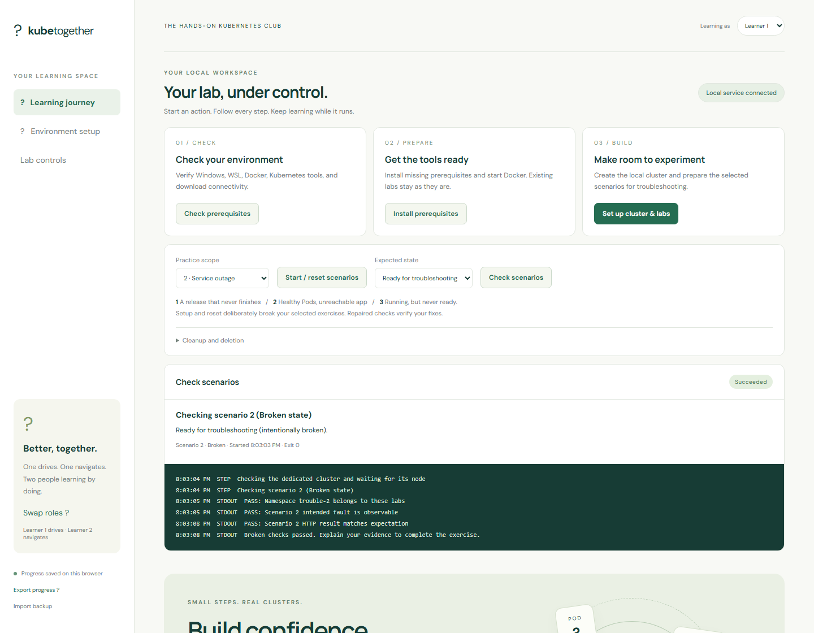

# K8s Training - Kube Together

Hands-on Kubernetes practice for beginners on Windows: eight guided lessons,
a browser dashboard, and three independently deployable troubleshooting incidents.
Run commands in PowerShell from this repository's root directory.

Contributions follow an issue -> task branch -> pull request workflow, with PRs
targeting `main`. See [repository instructions](AGENTS.md) for details.
Every implementation PR must update the affected documentation, commands,
examples and screenshots, or explain why documentation is unchanged. Include a
user-facing change summary; the versioned changelog/release workflow is tracked
in #4 and #10. Each release must package documentation matching its actual
version, prerequisites, launch/update flow, limitations and migration notes.

## Launch the management webpage

Install Node.js 22 or newer, then run from the repository root:

```powershell
powershell -NoProfile -File Start-K8Training.ps1
```

Or double-click `Run-K8Training.cmd`. The launcher checks Node, starts the local
service in the background and opens **http://127.0.0.1:8787**. No npm installation
or application build is needed to run it. It reuses a running instance of this
checkout. `-NoBrowser` starts it without opening a tab; `-Port 8789` selects another
port (use the same port consistently to retain browser-local learner progress).
Startup diagnostics are written to ignored `.tools/frontend/`.



The webpage can check/install prerequisites, create the cluster, start/reset
selected scenarios, validate intended faults or repairs, and confirm scoped
cleanup. PowerShell runs in the background with the actual current step,
timestamped logs and final exit result shown on the page. Refreshing reconnects
to the current operation; controls stay unavailable while another operation runs.
Setup/reset success means **ready for troubleshooting (intentionally broken)**.
Windows restart and manual setup requirements are shown separately from failures.

The service listens only on loopback and accepts predefined actions. It does not
elevate itself. Complete Docker onboarding or administrator-only WSL setup when
the page requests it, then retry. Closing the browser does not stop an operation.
Only the latest operation and its last 500 log lines are kept in server memory;
restarting the service clears this activity history. Learner journals stay in
browser storage. When moving from the static file to the local website, export
your progress from the old page and import it into the new page.
Avoid running separate CLI mutations while the webpage is operating on the same
cluster; the local service serializes its own requests, not external terminals.

For foreground operation, use `npm start` (or `node server/index.cjs`) and stop
with Ctrl+C; the service waits for any active action to finish before stopping.
The background launcher is intended to keep the service available while learning.
Changing source code requires restarting the service.

```powershell
powershell -NoProfile -File Stop-K8Training.ps1
```

Stopping is refused while a lab action is active and does not delete the cluster.
For a custom port, pass the same `-Port` to both launch and stop scripts.

## Start the troubleshooting labs from PowerShell

```powershell
git clone https://github.com/igusssv2/k8s-training.git
cd k8s-training
# Inspect prerequisites without installing anything:
powershell -NoProfile -File training/troubleshooting/Check-Prerequisites.ps1 -CheckNetwork
# Install/start prerequisites, create the cluster, and deploy all three incidents:
powershell -NoProfile -File training/troubleshooting/Setup-Lab.ps1
```

Setup supports Windows x64, WSL 2 and Docker Desktop with Linux containers.
It installs missing Docker Desktop through winget, starts its engine, downloads
SHA-256-verified kind/kubectl into ignored `.tools/`, and creates a dedicated local
cluster. WSL installation requires an administrator terminal; setup never elevates
or restarts Windows automatically. Docker onboarding may require manual completion.
Allow about 4 CPU cores, 8 GB RAM, 15 GB disk and public internet access.
No cloud account or application build is needed. Node is required for the local
web service; the PowerShell-only lab scripts work independently of it.

| Scenario | Incident | Namespace |
| --- | --- | --- |
| 1 | A release is stuck while the old version still serves traffic | `trouble-1` |
| 2 | Healthy Pods cannot be reached through their Service | `trouble-2` |
| 3 | Containers run but the application never becomes ready | `trouble-3` |

A successful setup leaves the scenarios **deliberately broken** for you to repair.
Read the [incident briefs and command guide](training/troubleshooting/README.md).

```powershell
# Verify your repair (defaults to Healthy):
powershell -NoProfile -File training/troubleshooting/Check-Lab.ps1 -Scenario 1
# Verify that all intended faults are present:
powershell -NoProfile -File training/troubleshooting/Check-Lab.ps1 -State Broken
# Reset one exercise:
powershell -NoProfile -File training/troubleshooting/Deploy-Lab.ps1 -Scenario 2
# Remove namespaces, or remove the entire dedicated cluster:
powershell -NoProfile -File training/troubleshooting/Delete-Lab.ps1
powershell -NoProfile -File training/troubleshooting/Delete-Lab.ps1 -DeleteCluster
```

`Setup-Lab.ps1 -PrerequisitesOnly` installs/checks prerequisites without touching
exercises. Setup/deploy can be repeated to reset labs. Checks return exit 0 on
success and 1 on failure; setup returns 2 when a Windows restart is needed.
The dedicated cluster is `k8s-troubleshooting`; its credentials stay in ignored
`.tools/k8s-troubleshooting/kubeconfig`. All scripts target that file and context.

## Guided eight-session course

Open `Run-K8Training.cmd` for the management website, or `dist/index.html` for
the static learning dashboard (lab controls are disabled without the service).
Follow the [course plan](training/README.md) and [environment setup](training/SETUP.md).
The guided course uses its own cluster, `k8training`, separate from the incidents.

Lessons cover Pods/controllers, scaling, Services/DNS, configuration/Secrets,
probes/rollouts, storage/Jobs, RBAC, and an incident capstone.
Progress and journals are stored per learner in the browser. Use Export progress
and Import backup when changing browsers or moving the local HTML file.
Guided lessons still provide commands for terminal practice; the separate lab
controls execute the standalone troubleshooting scripts through the local service.

## Repository and validation

- `dist/`: static dashboard and bundled lessons.
- `training/labs/`: guided exercises 01-08.
- `training/manifests/`: reference resources for the guided course.
- `training/troubleshooting/`: prerequisite, setup, deployment, check and cleanup scripts.
- `tests/`: dashboard regression tests using Node's built-in runner.
- `server/`: local HTTP/SSE service and predefined PowerShell action runner.

Runtime uses only built-in Node modules. Development/browser checks use the
locked Playwright dependency. Install test dependencies and Chromium once:

```powershell
npm ci
npx playwright install chromium
```

Run checks from repository root:

```powershell
npm run check
npm test
npm run test:browser
powershell -NoProfile -File training/scripts/Test-Course.ps1
powershell -NoProfile -File training/troubleshooting/Test-Lab.ps1
```

After editing guided lessons or SETUP.md, regenerate the checked-in bundle:

```powershell
node training/scripts/Sync-Course.cjs
```

PowerShell parsing and YAML whitespace checks provide basic linting; no external
formatter or linter is required. Formatting conventions are in `.editorconfig`.
`npm run check` is syntax validation; broader lint/spelling tooling is tracked in
issue #7. Browser tests use a separate local service on port 8788 with deterministic
child-process fixtures; they do not modify your real cluster. Failed-browser
traces are saved under ignored `.tools/browser-test-results/`.
HTTP/process tests verify parameter validation, origin/token checks, streaming,
reconnection, nonzero exits, missing PowerShell, and conflicting operations.
Real Docker/Kubernetes behavior is verified separately with live runtime tests.
The full live acceptance test resets all three namespaces, validates baselines,
faults, recovery and reset isolation, then removes the namespaces twice:

```powershell
powershell -NoProfile -File training/troubleshooting/Test-Lifecycle.ps1
```

It leaves the dedicated cluster running and empty. Run Setup or Deploy afterward
to prepare the incidents again. Never commit kubeconfigs, real tokens, credentials,
or local environment files. Practice Secrets contain fake values only.
